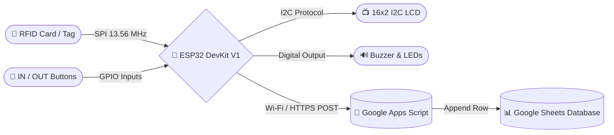
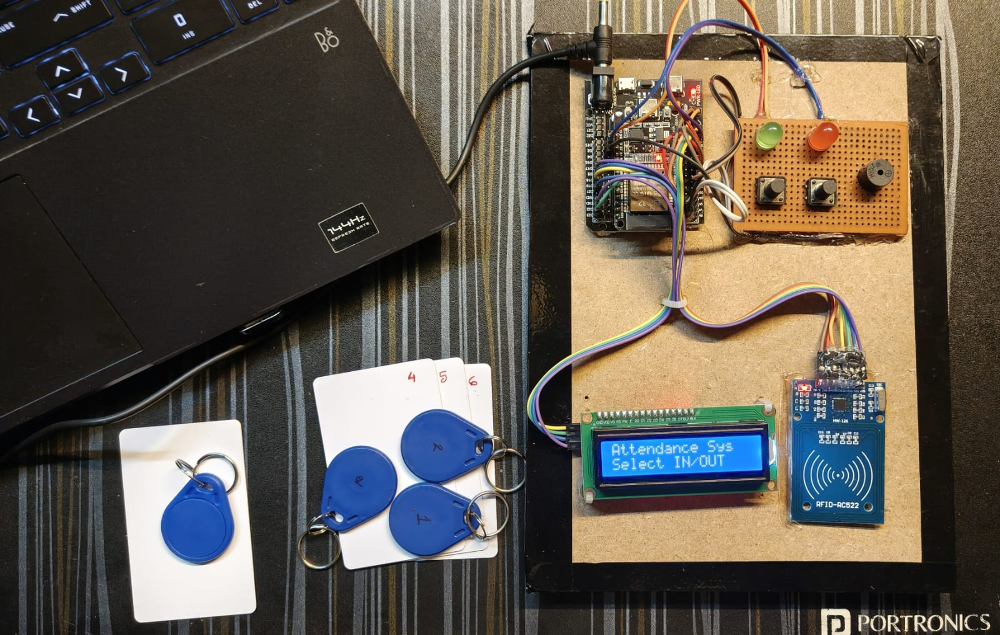

# 🎓 IoT-Based Smart Attendance System using ESP32 and RFID

<p align="center">
  
  
  
  
  
</p>

<p align="center">
  <b>A real-time, dual-mode (IN / OUT) contactless attendance logging system built using ESP32, MFRC522 RFID reader, and Google Apps Script.</b>
</p>

---

## 📑 Table of Contents

- [Overview](#-overview)
- [System Architecture](#-system-architecture)
- [Features](#-features)
- [Project Demo](#-project-demo)
- [Hardware Requirements](#-hardware-requirements)
- [Circuit Connections](#-circuit-connections)
- [Software & Libraries](#-software--libraries)
- [Google Sheets & Apps Script Setup](#-google-sheets--apps-script-setup)
- [Firmware Setup & Configuration](#-firmware-setup--configuration)
- [How to Use](#-how-to-use)
- [Future Enhancements](#-future-enhancements)
- [Troubleshooting](#-troubleshooting)
- [Authors](#-authors)
- [License](#-license)

---

## 🔍 Overview

This project replaces manual paper registers with an automated IoT-based attendance solution. When an RFID tag or card is scanned:
1. The **ESP32** identifies the card UID.
2. Checks the selected mode (**IN** for check-in / **OUT** for check-out) via push buttons.
3. Matches the student name and roll number.
4. Pushes an HTTPS payload to **Google Sheets** via **Google Apps Script**.
5. Provides immediate feedback via an **I2C 16x2 LCD display**, buzzer beeps, and LED indicators.

---

## 🏗️ System Architecture



---

## ✨ Features

- **Dual-Mode Tracking:** Dedicated tactile buttons to toggle between **IN** and **OUT** modes.
- **Real-Time Cloud Sync:** Directly logs `Date & Time`, `Card ID`, `Student Name`, `Roll No`, `Mode`, and `Status` into Google Sheets.
- **Instant LCD Feedback:** 16x2 I2C LCD displays network status, active mode, and student confirmation.
- **Audio/Visual Alerts:**
  - 🟢 **Green LED + 1 Beep:** Successful attendance record.
  - 🔴 **Red LED + 2 Beeps:** Unregistered card or connection error.
- **Anti-Duplicate Filter:** 3-second software debounce prevents accidental double-swiping.
- **Self-Healing Wi-Fi:** Automatically reconnects if Wi-Fi signal drops.

---

## 📸 Project Demo

### Hardware Prototype
<p align="center">
  
</p>

### 🎥 Working Video

<!-- This HTML code will play the video directly if the file is under GitHub's size limit -->
<video src="demo_video.mp4" controls="controls" style="max-width: 100%; width: 600px;">
  Your browser does not support the video tag.
</video>

<!-- 
⚠️ IF THE VIDEO ABOVE IS NOT PLAYING (black box or error):
1. Upload your video to YouTube.
2. Delete the <video> tags above.
3. Uncomment the line below and paste your YouTube link.
-->
<!-- [](https://www.youtube.com/watch?v=YOUR_YOUTUBE_LINK_HERE) -->

---

## 🛠️ Hardware Requirements

| Component | Quantity | Notes |
| :--- | :---: | :--- |
| **ESP32 DevKit V1** | 1 | Microcontroller with Wi-Fi & Bluetooth |
| **MFRC522 RFID Reader** | 1 | 13.56 MHz SPI Module |
| **RFID Cards / Key Fobs** | 5+ | S50 1K compatible tags |
| **16x2 I2C LCD Display** | 1 | PCF8574 backpack module |
| **Active Buzzer** | 1 | 3.3V – 5V DC buzzer |
| **Status LEDs (Green & Red)** | 2 | 5mm diffused LEDs |
| **220Ω Resistors** | 2 | Current limiters for LEDs |
| **Push Buttons** | 2 | Momentary buttons for IN/OUT mode |
| **Breadboard & Jumper Wires** | 1 set | For circuit assembly |

---

## 🔌 Circuit Connections

> ⚠️ **CRITICAL SAFETY NOTE:**  
> The **MFRC522 RFID reader MUST be powered by 3.3V**. Connecting to 5V will permanently damage the module. The **I2C LCD requires 5V (VIN)** for proper backlight and text contrast.

| Component | Module Pin | ESP32 GPIO | Operating Note |
| :--- | :--- | :--- | :--- |
| **MFRC522** | **3.3V (VCC)** | **3V3** | **3.3V Power only (Do NOT connect to 5V)** |
| | GND | GND | Ground |
| | RST | GPIO 27 | Reset Pin |
| | SDA (SS) | GPIO 5 | SPI Chip Select |
| | SCK | GPIO 18 | SPI Clock |
| | MOSI | GPIO 23 | SPI MOSI |
| | MISO | GPIO 19 | SPI MISO |
| **I2C LCD** | VCC | VIN (5V) | 5V Power Supply |
| | GND | GND | Ground |
| | SDA | GPIO 21 | I2C Serial Data |
| | SCL | GPIO 22 | I2C Serial Clock |
| **Buzzer** | Positive (+) | GPIO 25 | Active Buzzer Signal (Cathode to GND) |
| **LEDs** | Green Anode | GPIO 26 | Connect through 220Ω resistor |
| | Red Anode | GPIO 13 | Connect through 220Ω resistor |
| **Buttons** | IN Button | GPIO 32 | Configured with `INPUT_PULLUP` to GND |
| | OUT Button | GPIO 33 | Configured with `INPUT_PULLUP` to GND |

---

## 💻 Software & Libraries

1. Install **[Arduino IDE 2.x](https://www.arduino.cc/en/software)** with ESP32 board support.
2. Install the following libraries via the Arduino Library Manager (**Tools → Manage Libraries...**):
   - **MFRC522** *(by GithubCommunity)*
   - **LiquidCrystal I2C** *(by Frank de Brabander)*
   - **ArduinoJson** *(by Benoit Blanchon)*

---

## 📊 Google Sheets & Apps Script Setup

1. Create a new Google Sheet and add these headers in **Row 1**:
   `Date & Time` | `Card ID` | `Student Name` | `Roll No` | `Mode` | `Status`

2. Go to **Extensions → Apps Script**, paste the following script, and save:

```javascript
function doPost(e) {
  try {
    var sheet = SpreadsheetApp.getActiveSpreadsheet().getActiveSheet();
    var data = JSON.parse(e.postData.contents);
    var dateTime = Utilities.formatDate(new Date(), Session.getScriptTimeZone(), "dd-MM-yyyy HH:mm:ss");

    sheet.appendRow([
      dateTime, data.card_id, data.student_name, data.roll_no, data.mode, data.status
    ]);

    return ContentService
      .createTextOutput(JSON.stringify({status: "success"}))
      .setMimeType(ContentService.MimeType.JSON);
  } catch(err) {
    return ContentService
      .createTextOutput(JSON.stringify({status: "error", error: err.toString()}))
      .setMimeType(ContentService.MimeType.JSON);
  }
}
```

3. Click **Deploy → New deployment**.
4. Choose **Web app**, set:
   - **Execute as:** `Me`
   - **Who has access:** `Anyone`
5. Copy your **Web App URL** (ends in `/exec`).

---

## ⚙️ Firmware Setup & Configuration

### 1. Identify Your RFID Card UIDs
Flash the [test_rfid.ino](./test_rfid.ino) sketch to your ESP32. Open the **Serial Monitor (115200 baud)**, tap your cards, and note their UIDs (e.g., `B71C3459`).

### 2. Configure the Main Firmware
Open the [main_code.ino](./main_code.ino) file in Arduino IDE and update the configuration section:

```cpp
// 1. Wi-Fi Credentials
const char* WIFI_NAME = "YOUR_WIFI_SSID";
const char* WIFI_PASSWORD = "YOUR_WIFI_PASSWORD";

// 2. Google Script Web App URL
const char* GOOGLE_SCRIPT_URL = "YOUR_GOOGLE_SCRIPT_WEB_APP_URL"; // Must end in /exec

// 3. Student Database Mapping
Student students[] = {
  {"B71C3459", "Student One", "24030-EE-001"},
  {"97D09C59", "Student Two", "24030-EE-002"}
};
```

---

## 🚀 How to Use

1. Connect your ESP32 to your computer via USB.
2. Select **ESP32 Dev Module** in Arduino IDE under **Tools → Board**.
3. Upload the configured [main_code.ino](./main_code.ino) firmware.
4. Watch the LCD display until it says **"Wi-Fi Connected"**.
5. Press the **IN** or **OUT** button to select your mode.
6. Tap an RFID card to log attendance to Google Sheets instantly!

---

## 🚀 Future Enhancements

This project serves as a strong foundation for a commercial-grade attendance system. Potential future upgrades include:
- **Web Dashboard:** Building a Node.js or React frontend to visualize attendance data instead of relying solely on Google Sheets.
- **Database Migration:** Moving data from Google Sheets to a robust database like **Firebase** or **MySQL** to handle thousands of users without latency.
- **Biometric Integration:** Adding a fingerprint sensor (like the R307) alongside RFID for two-factor authentication.
- **Offline Cache:** Using the ESP32's built-in EEPROM or SPIFFS to store attendance locally if the Wi-Fi drops, and syncing to the cloud once reconnected.
- **Battery Backup:** Adding a Li-Po battery and TP4056 charging module for portable operation.

---

## 🔧 Troubleshooting

| Issue | Cause & Solution |
| :--- | :--- |
| **RFID Reader Not Working** | Verify SPI connections (GPIO 5, 18, 19, 23). Confirm module is connected to **3.3V, NOT 5V**. |
| **LCD Blank / Blue Blocks** | Adjust contrast potentiometer on the back of the I2C backpack using a small screwdriver. |
| **HTTP Error / No Data in Sheet** | Ensure Google Apps Script is deployed with **Who has access: Anyone**. Confirm ESP32 is on a **2.4 GHz Wi-Fi** network. |
| **Student Marked Unknown** | Check UID capitalization and verify the UID in [main_code.ino](./main_code.ino) matches the card read by [test_rfid.ino](./test_rfid.ino). |
| **Buzzer Clicks / Weak Sound** | Ensure an active buzzer is used and wired with proper polarity. |

---

## 👥 Authors

- **Rabbuni Merugumala** – *IoT & Embedded Systems Developer* 

---

## 📄 License

This project is licensed under the MIT License – see the [LICENSE](LICENSE) file for details.
```
